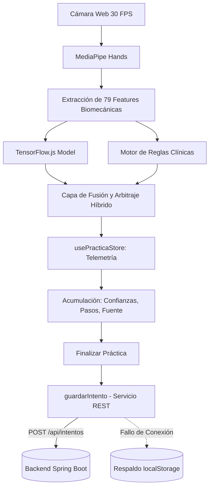

# Simulador de Técnica Estéril 🧤

> **Proyecto de Investigación:** *"Fortalecimiento de competencias técnicas en la postura de guantes quirúrgicos mediante el uso de una herramienta digital interactiva en estudiantes de enfermería"*  
> **Institución:** Universidad Cooperativa de Colombia — Campus Pasto  
> **Facultad:** Ciencias de la Salud • Programa de Enfermería  

---

## 📋 Descripción del Proyecto

El **Simulador de Técnica Estéril** es una aplicación web interactiva y progresiva (PWA) diseñada para el entrenamiento, evaluación y consolidación de las competencias clínicas de los estudiantes de enfermería en la **técnica abierta de postura de guantes quirúrgicos**.

La herramienta proporciona una experiencia inmersiva libre de riesgos, con retroalimentación inmediata sobre la cadena aséptica, detección de zonas de contaminación, validación biomecánica por visión artificial e Inteligencia Artificial, y registro analítico del desempeño estudiantil en el backend Spring Boot.

---

## 🚀 Módulos Funcionales

1. **🔐 Autenticación Simulada y Control de Roles:**
   - Validación reactiva mediante **React Hook Form** y esquemas **Zod** (nombre, semestre, grupo y credencial).
   - Control de perfiles con roles: `ESTUDIANTE`, `DOCENTE` y `ADMIN`.
   - Persistencia de sesión en `localStorage` con middleware `persist` de **Zustand**.
   - Guardias de navegación (`RutaProtegida`) que restringen módulos sensibles (`/admin/modelos-ia` y `/recolector`) exclusivamente al rol `ADMIN`.

2. **📊 Dashboard Analítico de Desempeño:**
   - Visualización de métricas reales consolidadas: total de prácticas, porcentaje de precisión promedio, tiempo récord y racha actual de intentos sin errores.
   - Gráfico de área interactivo con **Recharts** que expone la curva de aprendizaje de los últimos 10 intentos.
   - Lista cronológica de actividad reciente con distintivos por modalidad.

3. **🧊 Tutorial 3D con Entorno Quirúrgico Realista y Cinemático:**
   - **Renderizado PBR Fotorrealista:** Motor tridimensional basado en **Three.js**, **@react-three/fiber** y **@react-three/drei** con soporte de modelos GLTF/GLB (`manos_quirurgicas.glb`), sombras de contacto de alta fidelidad (`ContactShadows`) y mapeo de tonos **ACES Filmic**.
   - **Iluminación Quirúrgica de 3 Puntos + HDRI:** Configuración lumínica compuesta por *Key Light* (foco cialítico centrado), *Fill Light* (luz de relleno fría), *Rim Light* (destaque perimetral cian) y mapa de entorno HDRI de estudio (`Environment preset="studio"`).
   - **Ambientación Hospitalaria Completa:** Mesa de mayo en acero inoxidable quirúrgico con reflejos físicos, paño de campo estéril verde esmeralda (`#156e3f`), instrumental quirúrgico (bandeja, pinzas hemostáticas y tijeras de Mayo) y paredes de quirófano aséptico con niebla de profundidad.
   - **Cámara Cinematográfica Inteligente:** Transiciones dinámicas suaves e interpoladas (*lerp*) que viajan a encuadres óptimos para cada uno de los 6 pasos clínicos (vista amplia, laterales, cenital para entrada de guante, 3/4 y frontal), permitiendo en cualquier momento control orbital manual libre (`OrbitControls`).
   - **Pipeline de Post-procesamiento:** Integración con `@react-three/postprocessing` (Bloom especular en metales, Vignette óptico de enfoque y ToneMapping cinematográfico) con toggle de "Calidad alta" para optimizar dispositivos de gama baja.
   - **Fallback Anatómico Automático:** `ModelErrorBoundary` integrado que garantiza la continuidad educativa renderizando manos procedurales diferenciadas por asepsia si el archivo GLB no está presente o falla la carga.

4. **📋 Práctica Guiada (Paso a Paso):**
   - Progresión secuencial estricta donde cada paso requiere verificación de criterios asépticos para desbloquear el siguiente.
   - Puntos críticos basados en normativas de la OMS y guías de enfermería quirúrgica.
   - Acumulación de telemetría de validación clínica y envío automático de metadatos de IA al backend.
   - Cálculo automático de puntaje y celebración con confeti al finalizar.

5. **🖐️ Simulación Interactiva Háptica (Drag & Drop 2D):**
   - Espacio de trabajo delimitado por **Campo Quirúrgico Estéril** (zona segura esmeralda) y **Borde Contaminado / Suelo** (zonas de peligro carmesí).
   - Arrastre fluido con **@dnd-kit/core** de guantes e insumos.
   - Detección inmediata de colisiones asépticas con retroalimentación sonora sintetizada mediante **Web Audio API**.

6. **🤖 Módulo de Inteligencia Artificial Híbrida en Tiempo Real con Metadatos:**
   - **Procesamiento 100% Client-Side:** Inferencia local mediante WebAssembly y aceleración WebGL sin envío de video a servidores externos, garantizando privacidad médica estricta.
   - **Extracción Biomecánica de 79 Features:** Vector continuo invariante a traslación y escala (63 coordenadas relativas, 5 ángulos articulares de dedos, 10 distancias inter-puntas y 1 ángulo de orientación de la muñeca).
   - **Fusión y Arbitraje Híbrido:** Integra la red neuronal TensorFlow.js client-side con el sistema experto de reglas clínicas.
   - **Telemetría y Metadatos de IA:** Cada intento registra la versión del modelo activa, confianza promedio (`confianzaPromedio`), fuente predominante (`fuentePrediccion`: `'IA' | 'REGLAS' | 'CONSENSO' | 'MIXTO'`) y desglose serializado en JSON (`detalleIA`).
   - **Respaldo Offline:** Si la API REST no responde, el intento se respalda automáticamente en `localStorage` (`intentos_pendientes_sincronizacion`) para sincronización posterior.

7. **🛡️ Administración de Modelos de IA (`/admin/modelos-ia` - Solo ADMIN):**
   - Consulta de la versión actualmente activa desde `GET /api/ia/version/activa`.
   - Formulario de alta para registrar nuevas versiones (`POST /api/ia/version`): versión, accuracy, número de clases, muestras de entrenamiento, descripción y estado activo.
   - Tabla histórica de versiones consultada mediante `GET /api/ia/versiones`.

8. **🧪 Recolector de Datos de Entrenamiento (`/recolector` - Solo ADMIN):**
   - Grabación en ráfaga a 20 FPS (5 segundos por sesión, ~100 frames).
   - Selector para las 9 clases del protocolo con contadores por categoría hacia la meta de 200 muestras por clase.
   - Exportación de `dataset.json` para el pipeline de Machine Learning en Python.

9. **🏆 Modo Desafío (Evaluación Contrarreloj):**
   - Examen práctico con cuenta regresiva de **5:00 minutos**.
   - Escenarios clínicos de toma de decisión rápida sin ayudas visuales.
   - Registro de telemetría de validación y sincronización de puntajes con Spring Boot.

10. **👤 Perfil del Estudiante e Historial Editable:**
    - Ficha del estudiante con opción de modificación de nombre, semestre y grupo.
    - Historial detallado con filtros por modalidad (`Guiado`, `Simulación`, `Desafío`).

---

## 🔄 Flujo de Datos y Metadatos de IA



### Formato del Payload Enviado al Backend (`POST /api/intentos`)

```json
{
  "puntaje": 850,
  "tiempoSegundos": 225,
  "errores": 1,
  "modo": "SIMULACION",
  "pasosCompletados": 6,
  "confianzaPromedio": 0.87,
  "fuentePrediccion": "CONSENSO",
  "versionModelo": "v1.0-2026-10",
  "detalleIA": "{\"pasos\":[{\"numero\":1,\"correcto\":true,\"confianza\":0.92,\"fuente\":\"CONSENSO\",\"mensaje\":\"Lavado quirúrgico correcto\"}],\"confianzaPromedio\":0.87,\"fuenteDominante\":\"CONSENSO\",\"versionModelo\":\"v1.0-2026-10\"}"
}
```

---

## 🛠️ Stack Tecnológico

| Capa | Tecnologías |
| :--- | :--- |
| **Núcleo Frontend** | React 19, TypeScript estricto, Vite |
| **Visión por Computador** | `@mediapipe/tasks-vision` (HandLandmarker en modo VIDEO con WebGL/CPU) |
| **Machine Learning Client-Side** | `@tensorflow/tfjs` (LayersModel con aceleración WebGL) |
| **Cliente HTTP** | Axios con interceptores de Bearer JWT, 401 y 403 |
| **Enrutamiento y Guardias** | React Router DOM v7 con `RutaProtegida` por roles |
| **Estado Global y Telemetría** | Zustand (`usePracticaStore`, `useAuthStore`, `useProgresoStore`) |
| **Backend REST & Seguridad** | Java Spring Boot (`http://localhost:8080`), Autenticación JWT Bearer |
| **Testing** | Vitest para pruebas unitarias de stores y lógica |
| **Gráficos 3D** | Three.js, `@react-three/fiber`, `@react-three/drei` |
| **Interactividad Drag & Drop** | `@dnd-kit/core`, `@dnd-kit/utilities` |
| **Visualización de Datos** | Recharts (Responsive Area Chart) |
| **Formularios y Validación** | React Hook Form, Zod, `@hookform/resolvers` |
| **Audio Feedback** | Web Audio API (sintetizador de acordes C5/E5/G5 y alarmas asépticas) |
| **Iconografía** | Lucide React |

---

## 📁 Estructura del Código

```text
herramienta-guantes/
├── src/
│   ├── components/
│   │   ├── auth/ProtectedRoute.tsx
│   │   ├── layout/
│   │   │   ├── AppLayout.tsx
│   │   │   ├── Navbar.tsx
│   │   │   ├── Sidebar.tsx           # Menú lateral dinámico con enlaces por rol (ADMIN)
│   │   │   └── Footer.tsx
│   │   ├── RutaProtegida.tsx         # Guardia de navegación con filtro de rolRequerido
│   │   ├── SimulacionCamara.tsx      # Orquestador de práctica con visión y telemetría IA
│   │   ├── VideoCanvas.tsx           # Overlay de 21 landmarks en Canvas
│   │   └── PanelFeedback.tsx         # Panel con métricas en tiempo real e IA
│   ├── hooks/
│   │   ├── useHandTracking.ts        # Ciclo de vida de MediaPipe
│   │   ├── useIAValidation.ts        # Hook de inferencia híbrida y registro en store
│   │   ├── useVersionModelo.ts       # Consulta y sincronización de la versión activa de IA
│   │   └── useTimer.ts
│   ├── pages/
│   │   ├── AdminModelosIA.tsx        # Panel administrativo de versiones del modelo (/admin/modelos-ia)
│   │   ├── RecolectorDatos.tsx       # Laboratorio de captura de dataset (/recolector)
│   │   ├── Dashboard.tsx
│   │   ├── Login.tsx
│   │   ├── PracticaGuiada.tsx
│   │   ├── SimulacionCamaraPage.tsx
│   │   ├── ModoDesafio.tsx
│   │   └── Perfil.tsx
│   ├── services/
│   │   ├── api.ts                   # Cliente Axios centralizado con interceptores JWT, 401 y 403
│   │   ├── iaService.ts             # Carga y predicción de TensorFlow.js
│   │   ├── intentoService.ts        # Envío de intentos con metadatos y respaldo offline
│   │   └── modeloIAService.ts       # Endpoints /api/ia/version, /activa, /versiones
│   ├── store/
│   │   ├── __tests__/
│   │   │   └── usePracticaStore.test.ts # Tests unitarios de telemetría y metadatos
│   │   ├── useAuthStore.ts          # Manejo de usuarios y roles (ESTUDIANTE, ADMIN)
│   │   ├── usePracticaStore.ts      # Máquina de estados y telemetría de IA
│   │   └── useProgresoStore.ts      # Historial local persistido en localStorage
│   ├── types/
│   │   ├── index.ts                 # Tipos base, IntentoPractica con metadatos, ModeloIA
│   │   ├── ia.ts                    # ModeloIARequest, etiquetas y contratos de IA
│   │   └── mediapipe.ts             # Landmarks anatómicos
│   ├── utils/
│   │   ├── validacionHibrida.ts     # Fusión de TF.js y reglas clínicas
│   │   ├── features.ts              # Extracción biomecánica de 79 features
│   │   ├── puntuacion.ts
│   │   └── sound.ts
│   └── App.tsx                      # Configuración de rutas y sincronizador de versión activa
```

---

## 💻 Instrucciones de Ejecución

### Prerrequisitos
- **Node.js**: v18.0.0 o superior (recomendado v20+ o v22+).
- **npm**: v9+ o superior.
- **Backend**: Spring Boot activo en `http://localhost:8080`.

### 1. Instalar dependencias
```bash
npm install
```

### 2. Ejecutar la suite de pruebas unitarias
```bash
npm test
```

### 3. Iniciar el servidor de desarrollo
```bash
npm run dev
```
La aplicación estará disponible inmediatamente en `http://localhost:5173`.

### 4. Compilar para producción
```bash
npm run build
```

---

## 🔒 Consideraciones de Compatibilidad hacia Atrás y Privacidad

1. **Compatibilidad hacia atrás:** Todos los nuevos campos (`confianzaPromedio`, `fuentePrediccion`, `versionModelo`, `detalleIA`) son opcionales. Si se conecta a un backend anterior que no admita o devuelva estos campos, la interfaz gráfica sigue operando con total normalidad.
2. **Respaldo ante desconexión:** Si el servidor backend no responde en `POST /api/intentos`, el intento se respalda en `localStorage` con la clave `intentos_pendientes_sincronizacion` para reenviarlo cuando se restablezca la red.
3. **Privacidad médica estricta:** Nunca se transmiten imágenes, video ni coordenadas crudas de landmarks al backend; únicamente métricas analíticas calculadas en el dispositivo del estudiante.
4. **Optimización de carga:** El tamaño del payload de `detalleIA` está acotado para nunca exceder los 10 KB.

---

## 👥 Equipo de Investigación y Créditos
- **Proyecto de Grado:** Fortalecimiento de competencias técnicas en la postura de guantes quirúrgicos mediante el uso de una herramienta digital interactiva en estudiantes de enfermería.
- **Universidad:** Universidad Cooperativa de Colombia — Campus Pasto.
- **Año:** 2025 / 2026.
