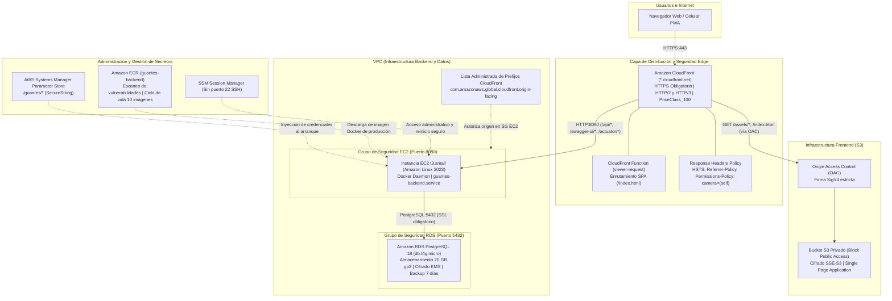

# Guía de Despliegue en AWS: Herramienta Digital para Postura de Guantes Quirúrgicos

Universidad Cooperativa de Colombia — Campus Pasto  
Facultad de Ingeniería — Programa de Ingeniería de Software  
Fecha objetivo de sustentación: 10 de noviembre de 2026  

---

## Diagrama de Arquitectura en AWS



---

## 0. Requisitos Previos

Antes de comenzar, asegúrate de contar con las siguientes herramientas instaladas en tu equipo local (Windows con PowerShell o Linux/macOS con Bash):

1. **Cuenta activa de AWS**: Acceso a la Consola de AWS con permisos de administrador en IAM.
2. **AWS CLI v2**: Instalado y verificado ejecutando:
   ```powershell
   aws --version
   ```
3. **Configuración de credenciales de AWS**:
   - Crea un usuario IAM con permisos administrativos y autenticación multifactor (MFA). **Nunca utilices las claves de acceso de la cuenta raíz**.
   - Ejecuta en tu terminal para configurar región y perfil:
     ```powershell
     aws configure
     ```
     - *AWS Access Key ID*: Tu clave de acceso IAM.
     - *AWS Secret Access Key*: Tu clave secreta IAM.
     - *Default region name*: `us-east-1` (o la región de tu preferencia).
     - *Default output format*: `json`.
4. **Docker Desktop**: En ejecución con soporte para contenedores Linux.
   ```powershell
   docker --version
   ```
5. **cfn-lint** (Linter oficial de CloudFormation):
   ```powershell
   cfn-lint --version
   ```

---

## 1. Crear una Alerta de Presupuesto en AWS Budgets

Para asegurar que los costos se mantengan controlados y no excedan el presupuesto académico, crea una alarma presupuestaria de **USD \$10 mensuales**:

1. Ingresa a la **Consola de AWS** > busca **AWS Budgets**.
2. Haz clic en **Create budget** (Crear presupuesto).
3. Selecciona **Cost budget - Recommended** (Presupuesto de costo).
4. Configura los parámetros:
   - **Budget name**: `presupuesto-guantes-quirurgicos`
   - **Period**: Monthly (Mensual)
   - **Budget effective date**: Recurring budget (Recurrente)
   - **Budgeted amount**: `10.00` USD
5. En la sección de alertas de notificación (**Set alert thresholds**):
   - Alerta 1: Cuando el costo real supere el **80%** (\$8 USD).
   - Alerta 2: Cuando el costo proyectado supere el **100%** (\$10 USD).
   - Ingresa tu correo electrónico institucional o personal para recibir las notificaciones.
6. Haz clic en **Confirm budget**.

---

## 2. Ejecutar `crear-secretos`

Los secretos nunca deben almacenarse en archivos del repositorio. Se guardan directamente en **AWS Systems Manager (SSM) Parameter Store** con cifrado `SecureString`:

- **En Windows (PowerShell)**:
  ```powershell
  cd c:\Proyecto_grado\guantes-backend\infra\aws\scripts
  .\crear-secretos.ps1 -Region us-east-1
  ```
- **En Linux/macOS (Bash)**:
  ```bash
  cd guantes-backend/infra/aws/scripts
  chmod +x crear-secretos.sh
  ./crear-secretos.sh
  ```

El script te solicitará interactivamente (sin mostrar caracteres en pantalla):
- `JWT_SECRET`: Presiona Enter para generar automáticamente una clave criptográfica de 48 bytes aleatorios (recomendado), o escribe una de al menos 32 caracteres.
- `DB_PASSWORD`: Contraseña maestra segura para PostgreSQL en Amazon RDS.
- `ADMIN_PASSWORD`: Contraseña para el usuario administrador inicial.
- `ADMIN_EMAIL`: Correo electrónico del administrador inicial (por defecto `admin@ucc.edu.co`).
- `CORS_ALLOWED_ORIGINS`: Dominio permitido (en este paso inicial puedes dejar `http://localhost:5173`; más adelante lo actualizaremos con la URL de CloudFront).

---

## 3. Desplegar `backend.yaml` y Anotar las Salidas

Este paso crea la infraestructura de base de datos RDS PostgreSQL 18, la instancia EC2 t3.small, el repositorio ECR y los grupos de seguridad.

- **En Windows (PowerShell)**:
  ```powershell
  cd c:\Proyecto_grado\guantes-backend\infra\aws\scripts
  .\desplegar-infra-backend.ps1 -StackName guantes-backend-stack -Region us-east-1
  ```
- **En Linux/macOS (Bash)**:
  ```bash
  cd guantes-backend/infra/aws/scripts
  chmod +x desplegar-infra-backend.sh
  ./desplegar-infra-backend.sh
  ```

El script consultará automáticamente tu VPC por defecto, seleccionará dos subredes disponibles y obtendrá el ID de la lista de prefijos de CloudFront (`com.amazonaws.global.cloudfront.origin-facing`).

Al finalizar el despliegue (toma entre 5 y 8 minutos mientras RDS se provisiona), verás en pantalla una tabla con las salidas:
- `EndpointRDS`: Endpoint DNS de PostgreSQL (ej. `guantes-backend-db.xxxx.us-east-1.rds.amazonaws.com`).
- `DnsPublicoEC2`: DNS público de la instancia EC2 (ej. `ec2-xx-xx-xx-xx.compute-1.amazonaws.com`). **Anota este valor, lo necesitarás en el paso 5**.
- `IdInstancia`: ID de la instancia EC2 (ej. `i-0123456789abcdef0`).
- `UriECR`: URI del repositorio de imágenes Docker (ej. `123456789012.dkr.ecr.us-east-1.amazonaws.com/guantes-backend`).

---

## 4. Ejecutar `publicar-backend`

Compila la imagen Docker de producción para arquitectura `linux/amd64`, la sube a Amazon ECR, reinicia el servicio systemd en la instancia EC2 vía SSM (sin necesidad de abrir el puerto 22 ni llaves SSH) y espera a que `/actuator/health` responda HTTP 200 `UP`:

- **En Windows (PowerShell)**:
  ```powershell
  cd c:\Proyecto_grado\guantes-backend\infra\aws\scripts
  .\publicar-backend.ps1 -StackName guantes-backend-stack -Region us-east-1
  ```
- **En Linux/macOS (Bash)**:
  ```bash
  cd guantes-backend/infra/aws/scripts
  chmod +x publicar-backend.sh
  ./publicar-backend.sh
  ```

---

## 5. Desplegar `frontend.yaml` con el DNS de EC2

Crea el bucket S3 privado con cifrado SSE-S3 y Block Public Access, el Origin Access Control (OAC), la función CloudFront para enrutamiento SPA y la distribución global de CloudFront con HTTPS obligatorio.

- **En Windows (PowerShell)**:
  ```powershell
  cd c:\Proyecto_grado\Proyectos_Guantes\infra\aws\scripts
  .\desplegar-infra-frontend.ps1 -StackName guantes-frontend-stack -BackendStackName guantes-backend-stack -Region us-east-1
  ```
- **En Linux/macOS (Bash)**:
  ```bash
  cd Proyectos_Guantes/infra/aws/scripts
  chmod +x desplegar-infra-frontend.sh
  ./desplegar-infra-frontend.sh
  ```

Al finalizar, el script mostrará las salidas del stack:
- `NombreBucket`: Nombre del bucket S3 generado.
- `IdDistribucion`: ID de la distribución de CloudFront (ej. `E1234EXAMPLE`).
- `UrlCloudFront`: Dominio público seguro asignado (ej. `https://d1234567890abc.cloudfront.net`). **Copia esta URL**.

---

## 6. Actualizar `CORS_ALLOWED_ORIGINS` y Reiniciar el Backend

Dado que el frontend y el backend ahora conviven bajo el dominio de CloudFront, actualizamos el parámetro en SSM y reiniciamos el contenedor para aplicar los cambios:

1. **Actualizar el parámetro en SSM**:
   - En PowerShell:
     ```powershell
     aws ssm put-parameter --name "/guantes/CORS_ALLOWED_ORIGINS" --value "https://<tu-distribucion>.cloudfront.net" --type "String" --overwrite --region us-east-1
     ```
   - En Bash:
     ```bash
     aws ssm put-parameter --name "/guantes/CORS_ALLOWED_ORIGINS" --value "https://<tu-distribucion>.cloudfront.net" --type "String" --overwrite --region us-east-1
     ```
2. **Reiniciar el backend en EC2**:
   - En PowerShell:
     ```powershell
     $instId = (aws cloudformation describe-stacks --stack-name guantes-backend-stack --query "Stacks[0].Outputs[?OutputKey=='IdInstancia'].OutputValue" --output text).Trim()
     aws ssm send-command --instance-ids "$instId" --document-name "AWS-RunShellScript" --parameters 'commands=["systemctl restart guantes-backend"]' --region us-east-1
     ```
   - En Bash:
     ```bash
     INST_ID=$(aws cloudformation describe-stacks --stack-name guantes-backend-stack --query "Stacks[0].Outputs[?OutputKey=='IdInstancia'].OutputValue" --output text)
     aws ssm send-command --instance-ids "$INST_ID" --document-name "AWS-RunShellScript" --parameters 'commands=["systemctl restart guantes-backend"]' --region us-east-1
     ```

---

## 7. Ejecutar `publicar-frontend`

Compila la aplicación React con Vite usando la configuración de producción (`VITE_API_URL=` vacía para peticiones en el mismo dominio), sincroniza los archivos en S3 aplicando directivas de caché diferenciadas y tipos MIME correctos, e invalida la caché de CloudFront para que los usuarios reciban la versión actualizada de inmediato:

- **En Windows (PowerShell)**:
  ```powershell
  cd c:\Proyecto_grado\Proyectos_Guantes\infra\aws\scripts
  .\publicar-frontend.ps1 -StackName guantes-frontend-stack -Region us-east-1
  ```
- **En Linux/macOS (Bash)**:
  ```bash
  cd Proyectos_Guantes/infra/aws/scripts
  chmod +x publicar-frontend.sh
  ./publicar-frontend.sh
  ```

---

## 8. Lista de Verificación en Producción

Abre tu navegador e ingresa a `https://<tu-distribucion>.cloudfront.net`:

- [ ] **Login**: Ingresa con las credenciales del usuario administrador configurado en SSM o regístrate como nuevo estudiante.
- [ ] **Registro de intento**: Completa una sesión guiada o de simulación y verifica que el puntaje y los pasos se almacenen correctamente en PostgreSQL.
- [ ] **Simulador con cámara en celular real**: Abre la URL en un dispositivo móvil con HTTPS. Comprueba que el navegador solicite permiso de cámara y que el video de MediaPipe detecte los landmarks correctamente (gracias a la directiva `Permissions-Policy: camera=(self)`).
- [ ] **Tutorial sin conexión (PWA)**: Ingresa a `/practica-guiada`, activa el modo avión en el celular y recarga la página. Comprueba que los 78 fotogramas clínicos se carguen desde el Service Worker.
- [ ] **Swagger UI**: Ingresa a `https://<tu-distribucion>.cloudfront.net/swagger-ui/index.html` y comprueba que la documentación interactiva OpenAPI cargue vía HTTPS sin advertencias de contenido mixto.
- [ ] **Endpoint Actuator**: Ingresa a `https://<tu-distribucion>.cloudfront.net/actuator/health` y confirma que devuelva `{"status":"UP"}` sin exponer datos sensibles del sistema.

### Comandos de Verificación con `curl`

Ejecuta estas pruebas en terminal (reemplazando `<tu-distribucion>` por tu subdominio de CloudFront):

```bash
# 1. Healthcheck de Actuator (debe responder HTTP 200 con {"status":"UP"})
curl -i https://<tu-distribucion>.cloudfront.net/actuator/health

# 2. Documentación OpenAPI (debe responder HTTP 200 con el JSON de especificación)
curl -i https://<tu-distribucion>.cloudfront.net/v3/api-docs

# 3. Encabezados de seguridad en el frontend (verificar HSTS, nosniff, DENY y Permissions-Policy)
curl -I https://<tu-distribucion>.cloudfront.net/

# 4. Enrutamiento SPA (una ruta profunda debe responder HTTP 200 devolviendo index.html)
curl -i https://<tu-distribucion>.cloudfront.net/practica-guiada

# 5. Endpoint protegido (debe rechazar con HTTP 401 Unauthorized sin token JWT)
curl -i https://<tu-distribucion>.cloudfront.net/api/auth/perfil
```

---

## 9. Monitoreo, Actualizaciones y Apagado para Ahorro de Costos

### Visualización de logs del backend
Para consultar los logs del contenedor Spring Boot en tiempo real mediante SSM:
- En PowerShell:
  ```powershell
  cd c:\Proyecto_grado\guantes-backend\infra\aws\scripts
  .\logs-backend.ps1 -Lines 100
  ```
- En Bash:
  ```bash
  cd guantes-backend/infra/aws/scripts
  ./logs-backend.sh 100
  ```

### Actualización de versiones de la aplicación
- **Si modificas código del backend**: Ejecuta `./publicar-backend.ps1` (o `.sh`). El script construirá la nueva imagen con el commit SHA, la publicará en ECR y reiniciará el contenedor en EC2 sin tocar la base de datos.
- **Si modificas código del frontend**: Ejecuta `./publicar-frontend.ps1` (o `.sh`). El script compilará el código, sincronizará S3 e invalidará la caché de CloudFront.

### Cómo apagar todo para evitar costos (Orden de borrado)
Cuando finalice la sustentación del proyecto de grado o durante períodos de inactividad, puedes destruir los recursos creados para detener la facturación por completo:

1. **Vaciar y eliminar el frontend**:
   - Vacía el bucket S3:
     ```powershell
     $bucket = aws cloudformation describe-stacks --stack-name guantes-frontend-stack --query "Stacks[0].Outputs[?OutputKey=='NombreBucket'].OutputValue" --output text
     aws s3 rm s3://$bucket --recursive
     ```
   - Elimina la pila de CloudFormation del frontend:
     ```powershell
     aws cloudformation delete-stack --stack-name guantes-frontend-stack --region us-east-1
     ```
2. **Eliminar la pila del backend y generar Snapshot final de RDS**:
   - Si deseas conservar una copia de seguridad final de la base de datos sin costo de cómputo:
     ```powershell
     aws rds create-db-snapshot --db-instance-identifier guantes-backend-db --db-snapshot-identifier snapshot-final-guantes-sustentacion --region us-east-1
     ```
   - Vacía el repositorio ECR:
     ```powershell
     aws ecr batch-delete-image --repository-name guantes-backend --image-ids "$(aws ecr list-images --repository-name guantes-backend --query 'imageIds[*]' --output json)" --region us-east-1
     ```
   - Elimina la pila de CloudFormation del backend:
     ```powershell
     aws cloudformation delete-stack --stack-name guantes-backend-stack --region us-east-1
     ```

---

## 10. Problemas Frecuentes y Soluciones

### Error 502 / 504 Bad Gateway en CloudFront
- **Causa**: La instancia EC2 aún está iniciando Spring Boot o el Security Group no permite el tráfico de CloudFront.
- **Solución**:
  1. Verifica el estado del servicio ejecutando `.\logs-backend.ps1`.
  2. Confirma que el parámetro `CloudFrontPrefixListId` del stack coincida con la lista `com.amazonaws.global.cloudfront.origin-facing`.
  3. Confirma que la instancia responda localmente a `curl http://localhost:8080/actuator/health`.

### Error de CORS en el navegador
- **Causa**: El parámetro `/guantes/CORS_ALLOWED_ORIGINS` contiene una URL distinta a la de CloudFront o incluye una barra `/` al final.
- **Solución**:
  - Actualiza SSM con la URL exacta sin barra final (ej. `https://d12345.cloudfront.net`) y reinicia el servicio con `systemctl restart guantes-backend`.

### Cámara bloqueada o permisos denegados en navegador móvil
- **Causa**: Falta el encabezado `Permissions-Policy: camera=(self)` o la página no se sirve bajo HTTPS.
- **Solución**:
  - CloudFront ya tiene configurado HTTPS obligatorio y la directiva `camera=(self)`. Verifica en las herramientas de desarrollador que el encabezado `Permissions-Policy` esté presente en la respuesta de red.

### Service Worker muestra versión vieja (PWA)
- **Causa**: El navegador tiene en caché local una versión anterior del service worker o del manifiesto.
- **Solución**:
  - El script `publicar-frontend` sube `sw.js` y `index.html` con `Cache-Control: no-cache, no-store, must-revalidate` e invalida CloudFront automáticamente. En el navegador, abre DevTools > Application > Service Workers > pulsa "Update on reload" o limpia el almacenamiento de la aplicación.

---

## 11. Costos Estimados (Capa Gratuita vs Post-Capa Gratuita)

La arquitectura fue diseñada bajo el principio de **máxima economía académica**:

| Servicio AWS | Recurso / Nivel | Capa Gratuita (Primeros 12 meses) | Post-Capa Gratuita / Estimado Mensual |
| :--- | :--- | :--- | :--- |
| **Amazon CloudFront** | Distribución global (`PriceClass_100`) | **1 TB de transferencia + 10M solicitudes HTTP/S** (Gratis permanentemente) | \$0.00 USD (tráfico académico típico < 5 GB) |
| **Amazon S3** | Bucket privado frontend (~50 MB) | **5 GB de almacenamiento + 20,000 GET** (Gratis 12 meses) | < \$0.05 USD / mes |
| **Amazon EC2** | `t3.small` (2 vCPU, 2 GB RAM, 20 GB gp3) | *Nota:* Capa gratuita cubre `t2.micro`/`t3.micro`. `t3.small` cuesta ~\$0.0208 USD/hora | ~\$15.00 USD / mes (o \$0.50 USD/día si solo se enciende para pruebas y sustentación) |
| **Amazon RDS** | PostgreSQL 18 `db.t4g.micro` (20 GB gp3) | **750 horas mensuales de db.t4g.micro + 20 GB gp3** (Gratis 12 meses) | ~\$13.00 USD / mes tras el año |
| **Amazon ECR** | Repositorio `guantes-backend` (10 imágenes) | **500 MB de almacenamiento privado** | < \$0.10 USD / mes |
| **AWS Systems Manager** | Parameter Store (Standard) | **Gratis permanentemente** | \$0.00 USD |
| **TOTAL ESTIMADO** | Con EC2 encendido 24/7 | **~\$15.00 USD / mes** | **~\$28.00 USD / mes** |
| **TOTAL MODO SUSTENTACIÓN** | Encendido solo 3 días (72 horas) | **<\$2.00 USD** | **<\$3.00 USD** |

> [!TIP]
> **Estrategia para costo mínimo**: Si detienes la instancia EC2 (`aws ec2 stop-instances --instance-ids <IdInstancia>`) cuando no estés realizando pruebas ni sustentando, el costo de cómputo se reduce a prácticamente cero.

---

## 12. Procedimiento de Rollback

Si una actualización presenta anomalías, el procedimiento de reversión es inmediato:

### Rollback del Backend
Amazon ECR mantiene el historial de imágenes etiquetadas por commit SHA (`git rev-parse --short HEAD`).
1. Identifica el tag de la versión estable previa:
   ```powershell
   aws ecr list-images --repository-name guantes-backend --query 'imageIds[*].imageTag' --output table --region us-east-1
   ```
2. Ejecuta en EC2 el comando de despliegue apuntando al tag anterior mediante SSM:
   ```powershell
   $instId = (aws cloudformation describe-stacks --stack-name guantes-backend-stack --query "Stacks[0].Outputs[?OutputKey=='IdInstancia'].OutputValue" --output text).Trim()
   $uriECR = (aws cloudformation describe-stacks --stack-name guantes-backend-stack --query "Stacks[0].Outputs[?OutputKey=='UriECR'].OutputValue" --output text).Trim()
   $tagPrevio = "<tag-anterior>"

   aws ssm send-command --instance-ids "$instId" --document-name "AWS-RunShellScript" --parameters "commands=[`"docker pull $uriECR:$tagPrevio`", `"docker stop guantes-backend || true`", `"docker rm guantes-backend || true`", `"docker run -d --name guantes-backend --restart unless-stopped -p 8080:8080 --env-file /etc/guantes/backend.env $uriECR:$tagPrevio`"]" --region us-east-1
   ```

### Rollback del Frontend
1. Cambia tu rama local al commit anterior funcional (`git checkout <commit-anterior>`).
2. Ejecuta nuevamente `.\publicar-frontend.ps1`. El script reconstruirá los estáticos, sobrescribirá S3 e invalidará la caché en CloudFront en menos de 60 segundos.

---

## 13. Preguntas Frecuentes para la Sustentación del Proyecto de Grado (FAQ Jurado)

### 1. ¿Por qué se unificó Frontend y Backend bajo un único dominio en CloudFront?
**Respuesta:** En arquitecturas tradicionales con dominios separados (ej. `app.com` y `api.com`), el navegador debe realizar solicitudes pre-vuelo HTTP `OPTIONS` (CORS) por cada llamada a la API, aumentando la latencia y la sobrecarga de red. Además, las cookies `SameSite` y las políticas de seguridad de contexto seguro (`getUserMedia` para cámara) son más complejas de gestionar. Al utilizar CloudFront con enrutamiento por rutas (`/api/*` hacia EC2 y `/*` hacia S3), el navegador percibe un único origen de primer nivel:
- **Cero problemas de CORS en producción.**
- **Reducción de latencia** al no requerir peticiones preflight repetidas.
- **Un solo certificado SSL/TLS**, simplificando la gestión criptográfica.

### 2. ¿Por qué se utilizó Amazon EC2 con Docker en lugar de AWS App Runner, ECS Fargate o Kubernetes (EKS)?
**Respuesta:**
- **Control de costos:** Kubernetes (EKS) cobra un valor fijo de \$72 USD/mes solo por el plano de control (sin incluir nodos de cómputo), lo cual es inviable para un presupuesto académico.
- **Simplicidad y reproducibilidad:** Una instancia `t3.small` con Docker administrado por `systemd` y orquestado mediante AWS Systems Manager proporciona aislamiento completo, bajo consumo y control directo sobre la JVM de Spring Boot (optimizada con `-XX:MaxRAMPercentage=75`), permitiendo a cualquier desarrollador depurar y reiniciar el servicio sin complejidad innecesaria.

### 3. ¿Por qué S3 + CloudFront para el frontend en lugar de servir los estáticos desde Spring Boot?
**Respuesta:**
- **Descarga de trabajo a la API:** El simulador incluye 78 fotogramas clínicos de alta calidad y modelos de MediaPipe/TensorFlow.js (~25 MB). Si Spring Boot sirviera estos archivos, la memoria y el ancho de banda del backend se saturarían.
- **Distribución geográfica y caché perimetral:** CloudFront entrega los activos estáticos desde el punto de presencia (PoP) de AWS más cercano al estudiante con compresión Gzip/Brotli, logrando tiempos de carga sub-segundo y permitiendo que la PWA se instale y funcione sin conexión.

### 4. ¿Por qué no hay puerto 22 (SSH) abierto en la instancia EC2?
**Respuesta:** Por el principio de **mínimo privilegio y reducción de superficie de ataque**. Dejar el puerto 22 abierto a Internet expone el servidor a escaneos y ataques de fuerza bruta continuos. En su lugar, se implementó **AWS Systems Manager (SSM) Session Manager**:
- La comunicación se establece de forma saliente a través del agente SSM mediante canales cifrados TLS.
- El acceso se audita en AWS CloudTrail con control granular de identidad IAM.
- No se requiere gestionar, rotar ni almacenar llaves privadas `.pem`.

### 5. ¿Cómo se protegen los secretos y contraseñas de la base de datos?
**Respuesta:** Ninguna contraseña, llave JWT ni credencial de base de datos se guarda en el repositorio ni en texto plano. Se utiliza **AWS Systems Manager Parameter Store** con tipo `SecureString` cifrado bajo **AWS KMS**. Al arrancar, el script de inicialización de la instancia EC2 (`UserData`) extrae los parámetros autorizados por el rol IAM de la máquina, genera el archivo protegido `/etc/guantes/backend.env` con permisos `600` (legible únicamente por `root`), y los inyecta como variables de entorno al contenedor Docker.

### 6. ¿Por qué se configuró `spring.jpa.hibernate.ddl-auto=update` en lugar de `validate`?
**Respuesta:** El proyecto no utiliza herramientas de migración estructurada (como Flyway o Liquibase). Al desplegar en una base de datos nueva en Amazon RDS, la instancia inicia sin tablas; configurar `validate` provocaría que la aplicación falle inmediatamente al arrancar por la ausencia del esquema. `update` permite que Hibernate cree automáticamente las tablas y restricciones necesarias en el primer inicio sin alterar datos en despliegues subsiguientes.

