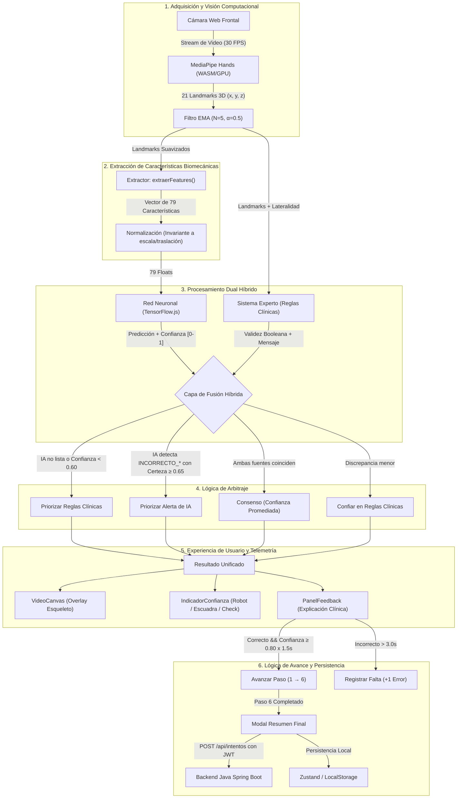

# Arquitectura del Sistema de Inteligencia Artificial Híbrido

**Proyecto de Investigación:** *"Fortalecimiento de competencias técnicas en la postura de guantes quirúrgicos mediante el uso de una herramienta digital interactiva en estudiantes de enfermería"*  
**Institución:** Universidad Cooperativa de Colombia — Campus Pasto  
**Facultad:** Ciencias de la Salud • Programa de Enfermería  

---

## 1. Visión General de la Arquitectura

El sistema de evaluación biomecánica implementa una **arquitectura híbrida client-side** que combina dos paradigmas complementarios de la Inteligencia Artificial:

1. **Aprendizaje Profundo (Red Neuronal en TensorFlow.js):** Clasificador entrenado que infiere patrones complejos de la mano a partir de 79 características geométricas normalizadas.
2. **Sistema Experto (Reglas Clínicas Simbólicas):** Validador determinista basado en geometría computacional 3D (ángulos articulares y distancias interdigitales) derivado de los protocolos de asepsia quirúrgica de la OMS.
3. **Capa de Fusión Adaptativa:** Módulo de arbitraje y consenso que unifica ambas fuentes para generar retroalimentación explicable, robusta y con alta tolerancia a ruido visual.

Todo el procesamiento ocurre **100% en el navegador web** del usuario mediante WebAssembly (WASM) y aceleración gráfica WebGL, cumpliendo con los estándares bioéticos de privacidad: **ninguna imagen ni flujo de video sale del dispositivo del estudiante**.

---

## 2. Diagrama de Flujo del Sistema (Mermaid)

---

## 3. Especificación del Vector de Características (79 Dimensiones)

Para garantizar que el modelo sea invariante a la distancia del estudiante respecto a la cámara, tamaño de la mano y posición dentro del encuadre, el extractor `extraerFeatures()` transforma los 21 puntos $(x, y, z)$ en un vector unificado de 79 valores:

| Rango de Índices | Cantidad | Descripción | Rango Normalizado |
| :--- | :---: | :--- | :---: |
| `[0 .. 62]` | 63 | **Coordenadas relativas tridimensionales:** Para los 21 landmarks, trasladados respecto a la muñeca ($landmark\ 0$) y divididos por la distancia máxima muñeca-punta ($d_{\max}$). | $[-1.0, 1.0]$ |
| `[63 .. 67]` | 5 | **Ángulos articulares de flexión/extensión:** Calculados para los 5 dedos (MCP-PIP-TIP / MCP-IP-TIP) y divididos por $180^\circ$. | $[0.0, 1.0]$ |
| `[68 .. 77]` | 10 | **Distancias euclidianas inter-puntas:** Las $\binom{5}{2}=10$ combinaciones entre las puntas (pulgar, índice, medio, anular y meñique) sobre las coordenadas escaladas. | $[0.0, 2.0]$ |
| `[78]` | 1 | **Ángulo de orientación de la mano:** Dirección del vector muñeca $\to$ nudillo medio (MCP 9) en el plano $XY$, normalizado con $\text{atan2} / \pi$. | $[-1.0, 1.0]$ |
| **Total** | **79** | **Vector continuo de entrada a la red neuronal** | — |

---

## 4. Filtro de Suavizado Temporal (EMA + Buffer Circular)

Para mitigar el temblor de alta frecuencia (*jitter*) propio de las cámaras web de baja resolución, se aplica un filtro de Media Móvil Exponencial:

$$\text{EMA}_t = \alpha \cdot \text{Landmark}_t + (1 - \alpha) \cdot \text{EMA}_{t-1}$$

Donde:
- $\alpha = 0.5$ (equilibrio óptimo entre eliminación de ruido y baja latencia de respuesta).
- Respaldado por un buffer circular FIFO de los últimos $N = 5$ fotogramas.

---

## 5. Reglas de Arbitraje en la Capa de Fusión

El módulo `validarHibrido` unifica la decisión según la siguiente matriz de prelación:

1. **Disponibilidad de IA:** Si el modelo de TensorFlow.js no ha cargado o no está disponible, el sistema conmuta automáticamente a **Modo Reglas Clínicas** (`fuente: 'reglas'`).
2. **Umbral de Incertidumbre:** Si la probabilidad asignada por la red neuronal es inferior a $0.60$, se desestima la predicción de la IA y se prioriza el sistema experto (`fuente: 'reglas'`).
3. **Detección Precoz de Contaminación:** Si la red neuronal clasifica con confianza $\ge 0.65$ una violación aséptica crítica (`INCORRECTO_contaminacion`, `INCORRECTO_tocar_exterior`, `INCORRECTO_pinza_debil`) que las reglas geométricas simples no detectaron, la IA toma precedencia diagnóstica inmediata (`fuente: 'ia'`).
4. **Consenso Clínico:** Si ambas fuentes coinciden (ambas aprueban o ambas rechazan), se reporta `fuente: 'consenso'` y se promedian las confianzas:
   $$\text{Confianza}_{\text{consenso}} = \frac{\text{Confianza}_{\text{Reglas}} + \text{Confianza}_{\text{IA}}}{2}$$
5. **Criterio Conservador:** Ante cualquier otra ambigüedad, prevalecen las reglas clínicas como garantía de asepsia quirúrgica.

---

## 6. Rendimiento y Privacidad

- **Tasa de Cuadros:** Limitada a 30 FPS mediante `requestAnimationFrame` y control de timestamp delta ($\ge 33.3\text{ ms}$).
- **Prevención de fugas de memoria:** Todas las inferencias de TensorFlow.js están encapsuladas en `tf.tidy()` para la recolección automática de tensores de WebGL.
- **Degradación Adaptativa:** Si la tasa de procesamiento desciende de 20 FPS continuos, el sistema reduce dinámicamente la resolución de captura a $320 \times 240$ píxeles.
- **Privacidad Estricta:** La cámara se procesa únicamente en la memoria volátil del navegador; ningún frame de video ni vector se transmite a servidores externos sin consentimiento explícito.
