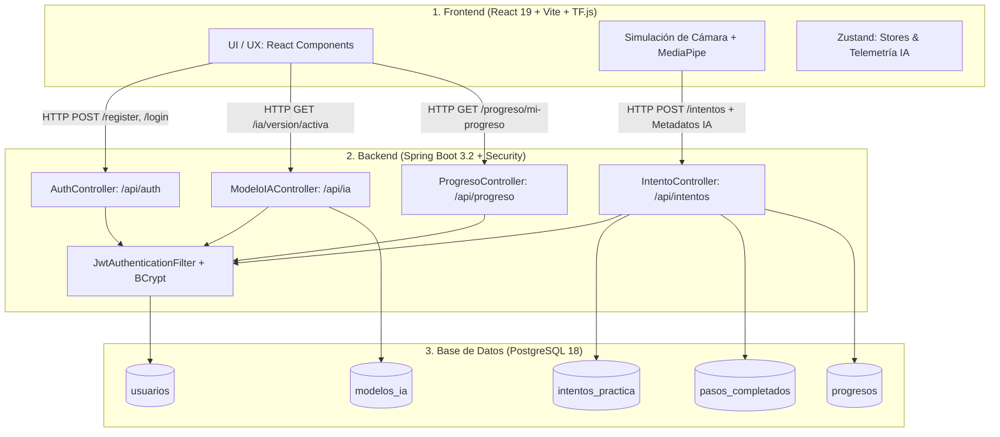

# Plan y Suite de Pruebas End-to-End (E2E) 🧪

> **Proyecto de Investigación:** *"Fortalecimiento de competencias técnicas en la postura de guantes quirúrgicos mediante el uso de una herramienta digital interactiva en estudiantes de enfermería"*  
> **Universidad:** Universidad Cooperativa de Colombia — Campus Pasto  
> **Facultad:** Ciencias de la Salud • Programa de Enfermería  
> **Área:** Ingeniería de Software / Evaluación de Calidad de Software  

---

## 📌 1. Visión General y Arquitectura de Pruebas

Este directorio contiene la especificación formal, los scripts de prueba, los datos semilla y las evidencias empíricas de la suite de pruebas **End-to-End (E2E)** diseñada para validar la integridad del sistema desde la interfaz de usuario hasta la persistencia relacional.



---

## 📂 2. Estructura Documental del Directorio

```text
docs/testing/
├── README.md                 # Este índice general y guía de ejecución
├── plan-pruebas.md           # Plan integral de aseguramiento de calidad (alcance, criterios, entorno)
├── casos-prueba.md           # Catálogo exhaustivo de casos de prueba detallados (Niveles 1 a 5)
├── seed-data.sql             # Script SQL de datos iniciales e idempotentes
├── coleccion-postman.json    # Colección importable de Postman con tests automatizados
├── resultados.md             # Matriz de ejecución y resultados obtenidos (Éxito / Fallo)
├── bugs-encontrados.md       # Bitácora formal de incidentes y defectos reportados
├── metricas-usabilidad.md    # Instrumentos de observación y resultados con estudiantes
├── informe-final.md          # Informe ejecutivo consolidado para el documento de grado
└── evidencias/               # Evidencias gráficas, capturas de pantalla y volcados de consola
    ├── db/                   # Resultados de consultas SQL y diagramas de tablas
    ├── api/                  # Respuestas HTTP (Postman / cURL)
    ├── frontend/             # Capturas de vistas, alertas y modales
    └── integracion/          # Telemetría cruzada y logs de Spring Boot
```

---

## ⚙️ 3. Configuración y Puesta a Punto del Entorno

### 3.1. Prerrequisitos del Sistema
- **Base de Datos:** PostgreSQL 18 activo en `localhost:5432` con usuario `postgres` y clave `1234`.
- **Backend:** Java 17+, Maven Wrapper (`mvnw.cmd`), Spring Boot 3.2.
- **Frontend:** Node.js 20+, npm 10+, Vite 8, navegador Google Chrome con aceleración WebGL.

### 3.2. Carga de Datos Semilla
Ejecutar el script SQL para reiniciar e inicializar la base de datos con los usuarios de prueba:

```powershell
$env:PGPASSWORD="1234"
& "C:\Program Files\PostgreSQL\18\bin\psql.exe" -U postgres -d guantes_db -f "c:\Proyecto_grado\docs\testing\seed-data.sql"
```

### 3.3. Inicio de Servicios
1. **Backend:**
   ```powershell
   cd c:\Proyecto_grado\guantes-backend
   .\mvnw.cmd spring-boot:run
   ```
   *Verificar en consola:* `Tomcat started on port 8080 (http)`

2. **Frontend:**
   ```powershell
   cd c:\Proyecto_grado\Proyectos_Guantes
   npm run dev
   ```
   *Verificar en consola:* `Local: http://localhost:5173/`

---

## 📊 4. Niveles de Prueba y Estrategia de Verificación

| Nivel | Enfoque | Casos de Prueba | Herramientas |
| :--- | :--- | :---: | :--- |
| **Nivel 1** | **Base de Datos (Aislada)** | DB-01 a DB-03 | PostgreSQL `psql`, pgAdmin 4 |
| **Nivel 2** | **API REST (Backend)** | API-01 a API-15 | Postman, Newman, cURL, Swagger UI |
| **Nivel 3** | **Integración End-to-End** | INT-01 a INT-10 | Chrome DevTools, React, MediaPipe, Spring Boot |
| **Nivel 4** | **Estrés y Casos Límite** | STRESS-01 a 03, EDGE-01 a 05 | Postman Runner, Scripts PowerShell |
| **Nivel 5** | **Usabilidad con Usuarios** | UX-01 | Rúbrica de evaluación clínica, estudiantes UCC |

---

## 👥 5. Cuentas de Acceso Preconfiguradas para Pruebas

| Rol | Correo Electrónico | Contraseña | Permisos y Alcance |
| :--- | :--- | :--- | :--- |
| **ADMIN** | `admin@ucc.edu.co` | `admin123456` | Gestión de versiones de IA, acceso a recolector, lectura global |
| **ESTUDIANTE** | `estudiante.base@ucc.edu.co` | `prueba123456` | Práctica clínica, guardado de intentos, consulta de progreso propio |
| **ESTUDIANTE (Nuevo)** | `prueba@ucc.edu.co` | `prueba123456` | Generado dinámicamente en casos de registro `API-01` e `INT-01` |
