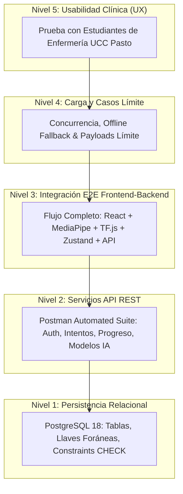

# Plan Integral de Pruebas End-to-End (E2E) 📋

> **Proyecto de Grado:** *"Fortalecimiento de competencias técnicas en la postura de guantes quirúrgicos mediante el uso de una herramienta digital interactiva en estudiantes de enfermería"*  
> **Institución:** Universidad Cooperativa de Colombia — Campus Pasto  
> **Facultad:** Ciencias de la Salud • Programa de Enfermería  
> **Programa Académico:** Ingeniería de Software  
> **Fecha de Documentación:** Octubre 2026  
> **Versión del Documento:** 1.0.0 — Fase 1 (Preparación & Especificación)

---

## 1. Introducción y Contexto

El aseguramiento de la calidad en aplicaciones de simulación médica orientadas al aprendizaje clínico demanda un enfoque riguroso de pruebas. El sistema evaluado es un simulador interactivo de postura de guantes quirúrgicos que combina visión computacional en el cliente (MediaPipe Hands + TensorFlow.js) con validación heurística clínica y persistencia centralizada en un backend robusto (Spring Boot 3.2 + PostgreSQL 18).

Este documento formaliza el **Plan Maestro de Pruebas End-to-End (E2E)**, cubriendo desde la consistencia física de la base de datos hasta la experiencia de interacción clínica de los estudiantes de enfermería de la Universidad Cooperativa de Colombia, campus Pasto.

---

## 2. Objetivos del Plan de Pruebas

### 2.1. Objetivo General
Diseñar, ejecutar y documentar una suite exhaustiva de pruebas en múltiples niveles arquitectónicos para validar la confiabilidad, seguridad, rendimiento y usabilidad del sistema "Simulador de Técnica Estéril" antes de su despliegue académico.

### 2.2. Objetivos Específicos
1. **Validación de Datos (Nivel 1):** Comprobar la integridad referencial, restricciones de dominio (constraints CHECK) y consistencia del modelo relacional en PostgreSQL 18.
2. **Validación de Servicios REST (Nivel 2):** Verificar el correcto funcionamiento del API Gateway/Backend, autenticación con tokens JWT, autorización basada en roles (RBAC), serialización de telemetría IA y manejo de excepciones HTTP.
3. **Validación de Integración E2E (Nivel 3):** Evaluar el flujo bidireccional entre la interfaz web React 19, el motor de inferencia en tiempo real y los servicios backend.
4. **Resiliencia y Casos Límite (Nivel 4):** Determinar la robustez de la plataforma frente a cargas de trabajo concurrentes, datos de inferencia voluminosos (>100 KB), pérdidas de conectividad (modo offline con localStorage) y restricciones de periféricos (cámara bloqueada).
5. **Evaluación de Usabilidad Clínica (Nivel 5):** Medir la experiencia y nivel de satisfacción de estudiantes de enfermería mediante pruebas con usuarios reales bajo la escala estandarizada System Usability Scale (SUS).

---

## 3. Alcance y Arquitectura de Pruebas



### 3.1. Componentes en Alcance
- **Frontend Web:** Interfaz SPA desarrollada en React 19, TypeScript y Vite, con componentes visuales de práctica guiada, simulación libre, modo desafío, panel de estadísticas y administración de modelos de IA.
- **Motor de Visión Computacional e IA Híbrida:** Pipeline cliente que integra `@mediapipe/tasks-vision`, `@tensorflow/tfjs` y el motor heurístico de arbitraje de reglas clínicas (`useIAValidation`, `iaService`).
- **Backend API REST:** Aplicación Spring Boot 3.2 con seguridad Stateless JWT, JPA/Hibernate, control de roles (`ROLE_ESTUDIANTE`, `ROLE_DOCENTE`, `ROLE_ADMIN`), y logging estructurado de telemetría de IA vía SLF4J.
- **Capa de Persistencia:** Base de datos relacional PostgreSQL 18 (`guantes_db`), compuesta por 5 entidades principales (`usuarios`, `intentos_practica`, `pasos_completados`, `progresos`, `modelos_ia`).

---

## 4. Entornos y Herramientas de Prueba

| Capa / Nivel | Herramienta | Versión / Detalle | Función Principal |
| :--- | :--- | :--- | :--- |
| **Persistencia** | PostgreSQL / `psql` | 18.3 x64 Windows | Verificación de DDL, restricciones y triggers |
| **API REST** | Postman / Newman | v10.x / CLI | Automatización de requests HTTP y aserciones Chai |
| **Backend Runtime** | Spring Boot / Java | 3.2.x / JDK 17 Eclipse Temurin | Servidor API REST (`http://localhost:8080`) |
| **Frontend Runtime** | Vite / React | Vite 5.x / React 19 / TypeScript 5.x | Servidor de desarrollo (`http://localhost:5173`) |
| **Unitarias Frontend** | Vitest | v3.0.7 | Pruebas unitarias de reducers y lógica Zustand |
| **Navegador Cliente** | Google Chrome | 130+ x64 con DevTools | Inspección de red, consola, memoria y permisos de cámara |
| **Telemetría e IA** | MediaPipe & TF.js | MediaPipe Tasks Vision 0.10.x / TF.js 4.x | Detección de 21 landmarks de mano en tiempo real |

---

## 5. Estrategia de Datos de Prueba (Seed Data)

Para asegurar la reproducibilidad e independencia de cada prueba, se implementó el script idempotente `docs/testing/seed-data.sql`:

1. **Limpieza Idempotente:** Eliminación en orden inverso de llaves foráneas para usuarios con identificadores de prueba (`prueba@ucc.edu.co`, `juan.test@ucc.edu.co`, `estudiante.base@ucc.edu.co`, etc.).
2. **Usuario Administrador:** `admin@ucc.edu.co` / `admin123456` (Hash BCrypt válido) con rol `ADMIN`.
3. **Usuario Estudiante Base:** `estudiante.base@ucc.edu.co` / `prueba123456` con rol `ESTUDIANTE`.
4. **Modelo de IA Inicial:** Versión `v1.0-2026-10` con `accuracy: 0.87`, `num_muestras: 2500` y estado `activo: true`.
5. **Intento y Progreso Semilla:** Intento previo con telemetría híbrida (`CONSENSO`, confianza `0.89`) para comprobar lecturas de métricas sin iniciar de cero.

---

## 6. Criterios de Entrada y Criterios de Aceptación/Salida

### 6.1. Criterios de Entrada (Entry Criteria)
- [x] Motor de base de datos PostgreSQL 18 en ejecución en el puerto 5432 con base de datos `guantes_db` activa.
- [x] Backend Spring Boot compilando sin errores (`mvnw test-compile`).
- [x] Frontend React compilando (`npm run build`) y pasando suite unitaria (`npm test`).
- [x] Script `seed-data.sql` ejecutado y validado en la base de datos.
- [x] Colección de Postman importada y parametrizada con variables de entorno (`baseUrl: http://localhost:8080`).

### 6.2. Criterios de Salida / Aceptación (Exit Criteria)
- **Tasa de Aprobación Global:** $\ge 95\%$ de casos de prueba ejecutados satisfactoriamente.
- **Bugs Críticos:** 0 bugs de severidad Crítica o Alta abiertos.
- **Integridad de Datos:** 100% de los intentos de práctica con telemetría de IA almacenan campos válidos (`confianza_promedio` $\in [0, 1]$, `fuente_prediccion` $\in$ catálogo válido, `detalle_ia` como JSON parseable).
- **Seguridad:** Los endpoints administrativos devuelven estrictamente `403 Forbidden` al ser invocados con tokens de rol `ESTUDIANTE` y `401 Unauthorized` sin token.
- **Documentación:** Generación completa de evidencias, tabla de bugs, métricas de usabilidad e informe ejecutivo para la tesis de grado.

---

## 7. Gestión de Defectos y Ciclo de Vida del Bug

Cada anomalía identificada durante las ejecuciones se reporta bajo el siguiente estándar estricto:

```text
**ID:** BUG-XXX
**Título:** Descripción concisa del fallo
**Severidad:** Crítica | Alta | Media | Baja
**Prioridad:** Alta | Media | Baja
**Componente:** Frontend | Backend | Base de datos | IA
**Pasos para reproducir:**
1. ...
**Resultado esperado:** ...
**Resultado obtenido:** ...
**Evidencia:** (archivo de captura o log en docs/testing/evidencias/)
**Ambiente:** Chrome 130+, Windows 11, Java 17, PostgreSQL 18
**Causa raíz:** Diagnóstico técnico
**Solución propuesta:** Corrección recomendada
**Estado:** Abierto | En progreso | Cerrado
```

---

## 8. Cronograma de Fases de Ejecución

| Fase | Descripción | Responsable | Estado |
| :---: | :--- | :--- | :---: |
| **Fase 1** | Preparación de entorno, datos semilla y especificación de casos | Antigravity AI / Investigador | **COMPLETO** |
| **Fase 2** | Ejecución de Pruebas de Base de Datos (Nivel 1: DB-01 a DB-03) | Antigravity AI / Investigador | Siguiente |
| **Fase 3** | Ejecución de Pruebas de API REST (Nivel 2: API-01 a API-15) | Antigravity AI / Investigador | Pendiente |
| **Fase 4** | Ejecución de Pruebas de Integración E2E (Nivel 3: INT-01 a INT-10) | Antigravity AI / Investigador | Pendiente |
| **Fase 5** | Pruebas de Estrés y Casos Límite (Nivel 4: STRESS-01 a EDGE-05) | Antigravity AI / Investigador | Pendiente |
| **Fase 6** | Pruebas de Usabilidad con Estudiantes (Nivel 5: UX-01) | Investigador / Estudiantes UCC | Pendiente |
| **Fase 7** | Consolidación de Resultados y Cierre de Bugs | Antigravity AI / Investigador | Pendiente |
| **Fase 8** | Redacción del Capítulo de Resultados de Pruebas para la Tesis | Antigravity AI / Investigador | Pendiente |
