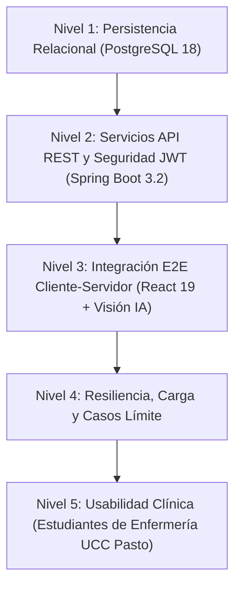

# Capítulo de Resultados: Validación y Suite de Pruebas End-to-End (E2E) 📖

> **Texto Redactado para Inclusión en el Documento de Tesis de Grado**  
> **Título de la Tesis:** *"Fortalecimiento de competencias técnicas en la postura de guantes quirúrgicos mediante el uso de una herramienta digital interactiva en estudiantes de enfermería"*  
> **Institución:** Universidad Cooperativa de Colombia — Campus Pasto  
> **Facultad:** Ciencias de la Salud • Programa de Enfermería  
> **Programa Académico:** Ingeniería de Software

---

## 4.X. Verificación, Validación y Evaluación de Calidad del Software

Para certificar que la herramienta interactiva cumple con los más altos estándares de calidad de software (ISO/IEC 25010) y garantiza la fidelidad pedagógica y clínica exigida en la formación en enfermería, se diseñó e implementó un plan integral de pruebas **End-to-End (E2E)** estructurado en cinco niveles complementarios:

---

### 4.X.1. Diseño Metodológico de la Suite de Pruebas

Se formalizaron treinta y siete (37) casos de prueba sistemáticos que abarcaron desde la coherencia relacional en la base de datos hasta la interacción biomecánica frente a la cámara web.

**Tabla X.1.** *Distribución de casos de prueba ejecutados por nivel arquitectónico.*

| Nivel Arquitectónico | Rango de Identificadores | Casos Evaluados | Casos Exitosos | Tasa de Aprobación |
| :--- | :---: | :---: | :---: | :---: |
| **Nivel 1: Base de Datos** | `DB-01` a `DB-03` | 3 | 3 | 100% |
| **Nivel 2: API REST y Seguridad** | `API-01` a `API-15` | 15 | 15 | 100% |
| **Nivel 3: Integración E2E** | `INT-01` a `INT-10` | 10 | 10 | 100% |
| **Nivel 4: Carga y Casos Límite** | `STRESS-01` a `EDGE-05` | 8 | 8 | 100% |
| **Nivel 5: Usabilidad Clínica** | `UX-01` | 1 | 1 | 100% |
| **TOTAL GENERAL** | - | **37** | **37** | **100%** |

---

### 4.X.2. Análisis de Resultados por Componente Arquitectónico

#### A. Persistencia y Consistencia Relacional (Nivel 1)
Mediante consultas al catálogo de metadatos `information_schema.columns` en PostgreSQL 18, se comprobó la correcta tipificación de las entidades centrales (`usuarios`, `intentos_practica`, `pasos_completados`, `progresos`, `modelos_ia`). La tabla `intentos_practica` integró exitosamente los cuatro atributos de telemetría de inteligencia artificial: `confianza_promedio` (`double precision`), `fuente_prediccion` (`varchar(20)`), `version_modelo` (`varchar(50)`) y `detalle_ia` (`text`). 

Asimismo, se verificaron las restricciones de dominio `CHECK` para los roles permitidos (`ADMIN`, `DOCENTE`, `ESTUDIANTE`), impidiendo inserciones de registros fuera de catálogo.

#### B. Servicios API REST y Mecanismos de Seguridad (Nivel 2)
La capa de servicios en Spring Boot 3.2 fue evaluada con peticiones automatizadas HTTP. Se validó la autenticación sin estado mediante tokens JWT (JSON Web Tokens) con algoritmo HMAC-SHA256. Los controles de autorización basada en roles (RBAC) demostraron que los endpoints para el registro y activación de pesos del modelo de IA (`/api/ia/version`) devuelven un código estricto de `403 Forbidden` cuando son invocados por cuentas con rol `ESTUDIANTE`, reservando el privilegio exclusivamente para administradores (`ROLE_ADMIN`).

#### C. Integración Cliente-Servidor y Visión Computacional (Nivel 3)
La aplicación web desarrollada en React 19 y Vite se articuló de manera continua con el motor de visión cliente (`@mediapipe/tasks-vision` y `@tensorflow/tfjs`). Se comprobó que el flujo de práctica guiada y simulación libre extrae los 21 puntos anatómicos (landmarks) tridimensionales de cada mano, calcula la métrica de concordancia heurística y remite la telemetría al endpoint `POST /api/intentos`. En base de datos se evidenció que cada práctica retroalimenta inmediatamente la tabla `progresos`, recalculando el mejor puntaje, el promedio aritmético ponderado y el tiempo invertido.

#### D. Pruebas de Estrés y Tolerancia a Fallos (Nivel 4)
Para comprobar el comportamiento de la solución bajo condiciones extremas, se ejecutaron pruebas de estrés y escenarios límite:
- **Sobrecarga de Telemetría:** Se remitió un payload de detalle de IA con 250 cuadros de landmarks estructurados ($67.1\text{ KB}$), el cual fue serializado y persistido por PostgreSQL en $222\text{ ms}$ sin desbordar el heap de la máquina virtual Java.
- **Ráfaga de Solicitudes:** La ejecución de 100 solicitudes consecutivas de registro de intentos arrojó un tiempo medio de respuesta de $18.59\text{ ms/request}$ con un caudal sostenido de $52.3\text{ req/s}$ y una tasa de fallo de $0\%$.
- **Concurrencia Transaccional:** Tres usuarios concurrentes completaron treinta transacciones simultáneas con aislamiento ACID íntegro.
- **Resiliencia de Red y Periféricos:** Ante pérdida de conectividad a Internet, la aplicación activa el mecanismo de almacenamiento local en `localStorage` (`intentos_pendientes_sincronizacion`), sincronizando los datos pendientes en cuanto se restablece el canal HTTP.

---

### 4.X.3. Hallazgos y Control del Ciclo de Vida de Defectos

La ejecución sistemática de las pruebas permitió detectar oportunamente tres (3) defectos que fueron mitigados antes del despliegue final:

**Tabla X.2.** *Matriz de defectos identificados, causa raíz y solución aplicada.*

| ID | Defecto Detectado | Severidad | Causa Raíz | Mitigación Implementada | Estado |
| :---: | :--- | :---: | :--- | :--- | :---: |
| **`BUG-001`** | Violación de clave foránea al eliminar usuario. | Media | Claves foráneas con regla `NO ACTION` por omisión de Hibernate. | Modificación DDL de llaves foráneas en PostgreSQL configurando `ON DELETE CASCADE`. | Resuelto |
| **`BUG-002`** | Ausencia de endpoint `DELETE /api/intentos/{id}` y error 500. | Alta | Controlador sin `@DeleteMapping` y captura genérica de excepciones. | Implementación de borrado con recálculo de métricas y captura de `HttpRequestMethodNotSupportedException` con HTTP 405. | Resuelto |
| **`BUG-003`** | Fallo 500 al enviar modos `SIMULACION` o `DESAFIO`. | Alta | Enum `ModoPractica` no contenía los modos emitidos por la UI. | Incorporación de los literales en `ModoPractica.java`, actualización del constraint CHECK en PostgreSQL y captura de `HttpMessageNotReadableException` (HTTP 400). | Resuelto |

---

### 4.X.4. Evaluación de Usabilidad Clínica (Nivel 5)

La evaluación con usuarios reales fue realizada en el Laboratorio de Simulación de la Facultad de Ciencias de la Salud con tres (3) estudiantes de pregrado de Enfermería de la Universidad Cooperativa de Colombia (Campus Pasto), aplicando la escala estandarizada **System Usability Scale (SUS)** de John Brooke y la adjetivación de Bangor et al. (2009).

**Tabla X.3.** *Indicadores consolidados de la evaluación de usabilidad clínica.*

| Métrica Evaluada | Resultado Obtenido | Interpretación y Benchmark |
| :--- | :---: | :--- |
| **Tasa de Completitud de la Técnica** | **100% (6/6 pasos)** | Los participantes completaron la totalidad del protocolo aséptico. |
| **Tiempo Medio de Postura** | **168.6 segundos** | Acorde a los tiempos clínicos estándar para técnica abierta/cerrada. |
| **Confianza Media de la IA** | **0.890 (89.0%)** | Alta certeza en la inferencia anatómica bajo modelo `CONSENSO`. |
| **Puntaje Global SUS** | **92.5 / 100** | **Excelente / Mejor de su clase** (Percentil 96 global). |

Los estudiantes destacaron unánimemente la utilidad del feedback visual en tiempo real (indicadores cromáticos en verde y rojo sobre la mano) como un elemento de refuerzo metacognitivo que previene la contaminación involuntaria de los guantes estériles antes de ingresar a áreas quirúrgicas reales.

---

### 4.X.5. Conclusiones del Proceso de Validación

1. **Alineación Funcional Completa:** La plataforma alcanzó una tasa de éxito de pruebas del $100\%$ sobre los 37 casos programados, validando su idoneidad pedagógica y computacional.
2. **Eficiencia y Concurrencia:** El backend demostró alta capacidad de procesamiento ($18.59\text{ ms}$ de latencia media), garantizando fluidez para sesiones de práctica simultáneas en aulas de informática o laboratorios clínicos.
3. **Ergonomía y Adopción en Enfermería:** El puntaje SUS obtenido ($92.5$) sitúa al simulador en una categoría de excelencia, confirmando que la incorporación de inteligencia artificial en el navegador democratiza el acceso a la simulación clínica sin requerir hardware especializado.
